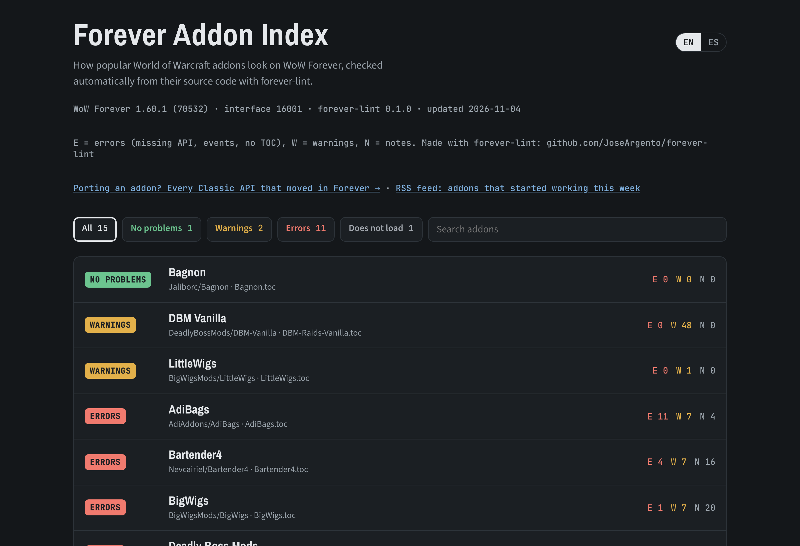

# forever-lint

Revisa addons de World of Warcraft y encuentra lo que se rompe en **WoW Forever**, antes de que lo encuentren tus usuarios.

Forever parece Classic, pero corre el cliente moderno: números de versión de Classic sobre la API de retail, con las restricciones a addons de Midnight. El código hecho para Classic Era se rompe de formas fáciles de pasar por alto:
- `GetSpellInfo` ya no existe;
- `WOW_PROJECT_ID` no es ni Classic ni retail;
- la vida puede llegar como valor secreto;
- y un addon que solo trae `_Vanilla.toc` directamente no carga.

[Read in English](README.md)



**En vivo:** [Índice de addons de Forever](https://joseargento.github.io/forever-lint/) · [Tabla de API movidas](https://joseargento.github.io/forever-lint/api.html) · [Feed RSS: addons que empezaron a andar esta semana](https://joseargento.github.io/forever-lint/feed.xml)

**Contenido**

- [Instalar y usar](#instalar-y-usar)
- [Qué revisa](#qué-revisa)
- [Con luacheck o con el editor](#con-luacheck-o-con-el-editor)
- [En CI](#en-ci)
- [Índice de compatibilidad](#índice-de-compatibilidad)
- [De dónde salen los datos](#de-dónde-salen-los-datos)
- [Feed "ya anda en Forever"](#feed-ya-anda-en-forever)
- [Límites](#límites)
- [Apoyar](#apoyar)

## Instalar y usar

```bash
pip install forever-lint      # Python 3.10+, sin dependencias
forever-lint ruta/a/MiAddon    # un addon, un repo con varios, o la carpeta AddOns entera
```

## Qué revisa

| Regla | Severidad | Qué |
|---|---|---|
| **FL001** | error | Función, namespace o función de la UI de Blizzard que no existe en Forever, con su reemplazo cuando lo hay. También `hooksecurefunc("Nombre", ...)` sobre una global que no existe, que tira error. |
| **FL002** | warning | API que solo existe como alias de compatibilidad de Blizzard (mientras el CVar `loadDeprecationFallbacks` está prendido). Blizzard avisa que los va a sacar. |
| **FL003** | warning | Cuentas o comparaciones con lo que devuelve una función documentada como "secret" (`UnitHealth`, `UnitPower` en ciertos casos...). En un addon eso tira un error de Lua. |
| **FL004** | warning | Comparaciones con `WOW_PROJECT_ID`, con lo que dan en Forever (18, `WOW_PROJECT_CAMELOT`). |
| **FL005** | error | `RegisterEvent("EVENTO")` de un evento que Forever no tiene. |
| **FL006** | warning | Eventos restringidos o con payload secreto, como `COMBAT_LOG_EVENT_UNFILTERED`. |
| **FL007** | warning | Chequeos de `select(4, GetBuildInfo())`: Forever reporta 16001, así que `>= 100000` da falso. |
| **FL008** | error | No hay un TOC que Forever cargue (busca `_Camelot`, `_Forever`, `_Mainline` y después el `.toc` sin sufijo). |
| **FL009** | warning | El `## Interface:` del TOC no incluye 16001, así que el addon aparece como desactualizado. |
| **FL010** | nota | El TOC excluye a Forever con `AllowLoadGameType`/`ExcludeLoadGameType`. Está bien si es a propósito. |
| **FL011** | nota | `SendChatMessage` con SAY, YELL o EMOTE: fuera de instancias necesita que el jugador apriete algo (EMOTE desde 1.60.1). Dentro de instancias, un tester de la beta reportó que ya no anda (18/10, sin confirmar). |
| **FL012** | nota | Las cuentas de prueba no pueden mandar mensajes de addon (1.60.1). Sale una vez por addon. |
| **FL013** | nota | Eventos que, según un autor de addons en la beta (18/10, sin confirmar), se comportan distinto en Forever: `PLAYER_DEAD` y `MERCHANT_CLOSED`/`AUCTION_HOUSE_CLOSED` saltan dos veces, y la zona justo después de `ZONE_CHANGED_NEW_AREA` puede venir vieja o vacía al viajar. |

Revisa solo los archivos que carga el TOC que elige Forever (incluyendo `[AllowLoadGameType]` por archivo y los `<Script>`/`<Include>` de los XML). Así no reporta código de otros clientes.

Para no llenarte de falsos positivos:
- sigue los alcances de Lua, así que un `local GetSpellInfo` no salta;
- reconoce los polyfills (`GetSpellInfo = GetSpellInfo or function ...`);
- los guards (`if GetMouseFocus then`) salen como notas;
- también es nota el fallback que viene después de chequear el reemplazo (`if C_Item and C_Item.GetItemSpell then ... end return GetItemSpell(id)`);
- las librerías embebidas (`Libs/`) salen resumidas y nunca hacen fallar la corrida.

Silenciar: `-- forever-lint: ignore FL001` en la línea, `-- forever-lint: ignore-next-line`, `-- forever-lint: ignore-file`, o `--ignore FL002,FL004`.

## Con luacheck o con el editor

`forever-lint --export-luacheck` imprime un bloque `read_globals` para `.luacheckrc` con toda la API de Forever (sin los alias de compatibilidad). `forever-lint --export-luals > forever-api.lua` imprime un archivo `---@meta` para [LuaLS](https://luals.github.io): un stub por cada función de Forever, por namespace, con los alias de compatibilidad marcados `---@deprecated` y una nota en las que devuelven valores secretos. Sumá su carpeta a `workspace.library` en `.luarc.json`. Son solo nombres: el linter no conoce tipos ni argumentos. Ni la extensión de Ketho ni wowlua-ls tienen todavía un sabor Forever (revisado el 4/11/2026); mandarles este dato es el plan ⏳.

## En CI

```yaml
      - uses: JoseArgento/forever-lint@v0
        with:
          path: .
```

Sube un SARIF a code scanning, así los hallazgos aparecen como anotaciones en el pull request (hace falta `security-events: write`).

## Índice de compatibilidad

`index/` arma una web estática: corre forever-lint sobre addons populares con repo público en GitHub (`index/addons.json`) y la publica en GitHub Pages cada semana. Muestra archivo, línea y mensaje de cada hallazgo, nunca el código de los addons. Para sumar un addon, abrí un pull request con su repo en `index/addons.json`; para sacar el tuyo, abrí un issue y sale en la corrida siguiente. Hoy son 47 addons.

Cada addon del índice tiene además un **badge** en `badge/<slug>.json` (formato endpoint de shields.io: *ready*, *N warnings*, *N errors* o *won't load*), para que su autor muestre el estado en su README:

```markdown

```

El slug es el nombre del addon en minúsculas, con todo lo que no es letra o número cambiado por `-` (`Details! Damage Meter` → `details--damage-meter`); está en `data.json`.

La misma web tiene una **tabla de API movida** (`api.html`, también como `api.json`): cada función que existía en algún Classic y en Forever no está, se movió o está restringida, con su reemplazo, más los alias de compatibilidad, los valores secretos y los eventos.

## De dónde salen los datos

`tools/build_db.py` arma `src/forever_lint/data/api.json`, y un workflow semanal lo regenera cuando Blizzard parchea Forever:
- La API que existe en cada cliente sale de los dumps de [Ketho/BlizzardInterfaceResources](https://github.com/Ketho/BlizzardInterfaceResources), con su historial desde 2019.
- Los alias de compatibilidad, los reemplazos, los valores secretos y los eventos restringidos salen del código de la UI de Blizzard (espejo [Gethe/wow-ui-source](https://github.com/Gethe/wow-ui-source)), incluida `Blizzard_APIDocumentationGenerated`.

Solo se publican nombres y flags; nada de código de Blizzard.

## Feed "ya anda en Forever"

Cada semana el índice se compara con el anterior, y los addons que mejoraron (de "no carga" a "carga", o de errores a limpio) salen en un feed RSS, `feed.xml`, en el mismo sitio. Para mandarlos también a un canal de Telegram: creá un bot con @BotFather, sumalo al canal y cargá `TELEGRAM_BOT_TOKEN` y `TELEGRAM_CHAT_ID` como secretos del repo. Sin ellos ese paso no corre.

## Límites

- Es análisis léxico: no sabe qué rama de un `if esClassic then ... else ... end` corre en Forever.
- "Probably replaced by" es un reemplazo encontrado por nombre. Revisá argumentos y retornos (muchas `C_` devuelven una tabla).
- Todavía no revisa métodos de widgets ni constantes globales.
- Los eventos los lee de textos fijos (`RegisterEvent("PLAYER_DEAD")`) y, si un archivo los registra desde una variable (`for event in pairs(handlers) do frame:RegisterEvent(event) end`), de las claves de sus tablas de manejadores (`PLAYER_DEAD = function`). Los que se arman al correr (`"UNIT_" .. tipo`) no los sigue.

## Apoyar

Todo esto es gratis y de código abierto, y va a seguir así: no hay funciones pagas ni nada antes para quien aporta. Si te sirvió y querés bancar el tiempo de mantenerlo (con cada parche de Blizzard hay que actualizar los datos y arreglar lo que se rompe), podés hacerlo en [Patreon](https://www.patreon.com/cw/DoblePupi). Gracias ♥

Sin relación con Blizzard Entertainment. World of Warcraft es marca registrada de Blizzard Entertainment, Inc. Licencia MIT.
