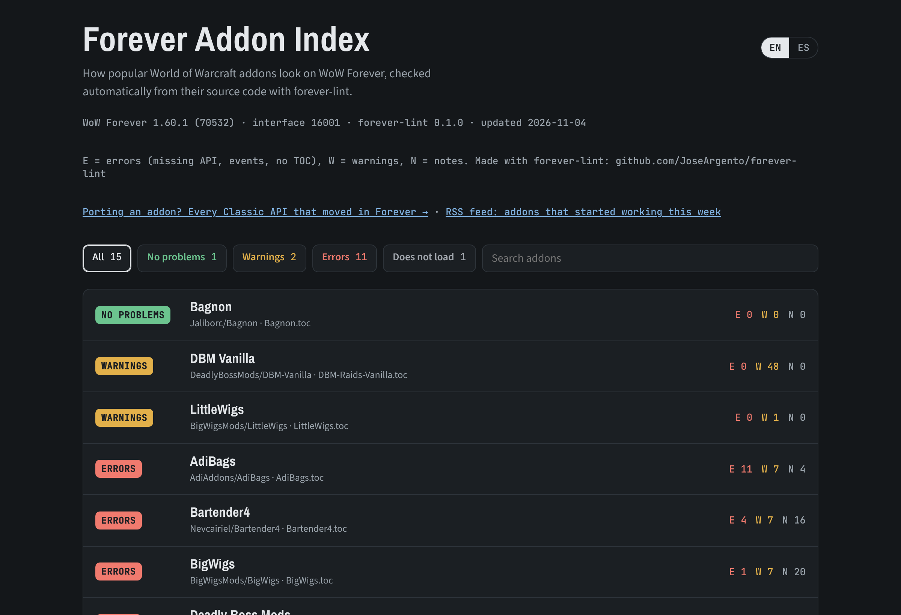

# forever-lint

Checks World of Warcraft addons for problems on **WoW Forever**, before your users find them.

Forever looks like Classic but runs the modern client: Classic-era version numbers on top of the retail API, with Midnight's addon restrictions. Code written for Classic Era breaks in ways that are easy to miss: `GetSpellInfo` is gone, `WOW_PROJECT_ID` is neither Classic nor retail, health values can be secret, and an addon with only a `_Vanilla.toc` does not load at all.

```
$ forever-lint MyAddon
forever-lint 0.2.0 · WoW Forever 1.60.1 (70532), interface 16001

MyAddon  (MyAddon, MyAddon.toc, 2 Lua files)
  warning FL009 MyAddon.toc declares Interface 11509, 120105 but Forever is 16001: the addon shows as out of date ...

MyAddon/Core.lua
  2:22  error FL001 `GetSpellInfo` does not exist in Forever. Probably replaced by `C_Spell.GetSpellInfo`. Note: `C_Spell.GetSpellInfo` returns a SpellInfo table, not separate values.
  4:19  warning FL004 In Forever `WOW_PROJECT_ID` is 18 (`WOW_PROJECT_CAMELOT`), so `WOW_PROJECT_ID == WOW_PROJECT_CLASSIC` is false. ...
  10:10  warning FL003 `hp` holds the result of `UnitHealth`, which can return a secret value in Forever (always). ...
  14:17  warning FL006 Event `COMBAT_LOG_EVENT_UNFILTERED`: the combat log is restricted for addons in Forever ...
  18:16  error FL001 `GetItemInfo` does not exist in Forever. Use `C_Item.GetItemInfo`.

8 errors, 6 warnings, 1 note in 1 addon(s)
```

[Leer en castellano](README.es.md)



**Live:** [Forever Addon Index](https://joseargento.github.io/forever-lint/) · [API migration table](https://joseargento.github.io/forever-lint/api.html) · [RSS feed: addons that started working this week](https://joseargento.github.io/forever-lint/feed.xml)

**Contents**

- [Install](#install)
- [What it checks](#what-it-checks)
- [With luacheck, your editor or pre-commit](#with-luacheck-your-editor-or-pre-commit)
- [Options](#options)
- [In CI (GitHub Actions)](#in-ci-github-actions)
- [Compatibility index](#compatibility-index)
- [Where the data comes from](#where-the-data-comes-from)
- [Limitations](#limitations)
- [Tested on](#tested-on)
- [Support](#support)
- [License](#license)

## Install

```bash
pip install forever-lint      # Python 3.10+, no dependencies
forever-lint path/to/MyAddon   # one addon, a repo with several, or your whole AddOns folder
```

## What it checks

| Rule | Severity | What |
|---|---|---|
| <a id="fl001-removed-api"></a>**FL001** removed-api | error | A function, namespace or Blizzard UI function that does not exist in Forever, with its replacement when there is one. Also `hooksecurefunc("Name", ...)` on a missing global, which raises an error. |
| <a id="fl002-deprecated-api"></a>**FL002** deprecated-api | warning | API that only exists as one of Blizzard's deprecation fallbacks (loaded while the `loadDeprecationFallbacks` CVar is on). Blizzard says these will be removed. |
| <a id="fl003-secret-value"></a>**FL003** secret-value | warning | Arithmetic or comparisons on the result of a function documented to return secret values (`UnitHealth`, `UnitPower` when restricted, `frame:GetFrameStrata()` since 1.60.1, ...). In addon code that raises a Lua error. |
| <a id="fl004-project-id"></a>**FL004** project-id | warning | `WOW_PROJECT_ID` comparisons, with what they evaluate to in Forever (18, `WOW_PROJECT_CAMELOT`). Lines that already mention `WOW_PROJECT_CAMELOT` are notes. |
| <a id="fl005-removed-event"></a>**FL005** removed-event | error | `RegisterEvent("EVENT")` for an event Forever does not have. |
| <a id="fl006-restricted-event"></a>**FL006** restricted-event | warning | Events with restrictions or secret payloads, such as `COMBAT_LOG_EVENT_UNFILTERED`. |
| <a id="fl007-build-version"></a>**FL007** build-version | warning | `select(4, GetBuildInfo())` checks: Forever reports 16001, so "modern client" tests like `>= 100000` are false. |
| <a id="fl008-no-forever-toc"></a>**FL008** no-forever-toc | error | No TOC that Forever loads. It looks for `_Camelot`, `_Forever`, `_Mainline`, then the plain `.toc`. |
| <a id="fl009-toc-interface"></a>**FL009** toc-interface | warning | The TOC's `## Interface:` does not list 16001, so the addon shows as out of date. |
| <a id="fl010-toc-game-type"></a>**FL010** toc-game-type | note | The TOC excludes Forever with `AllowLoadGameType`/`ExcludeLoadGameType`. Fine if on purpose. |
| <a id="fl011-chat-hardware-event"></a>**FL011** chat-hardware-event | note | `SendChatMessage` with SAY, YELL or EMOTE: outside instances it needs a key press or click (EMOTE since 1.60.1). Inside instances a beta tester reported it no longer works at all (18/10, not confirmed). |
| <a id="fl012-trial-addon-messages"></a>**FL012** trial-addon-messages | note | Trial accounts cannot send addon messages (1.60.1). Reported once per addon. |
| <a id="fl013-beta-event-quirk"></a>**FL013** beta-event-quirk | note | Events an addon author reported behave differently in Forever's beta (18/10, not confirmed): `PLAYER_DEAD` and the `MERCHANT_CLOSED`/`AUCTION_HOUSE_CLOSED` pair fire twice, and the zone text right after `ZONE_CHANGED_NEW_AREA` can be stale or empty after travelling. |

It follows the TOC Forever would pick, including `[AllowLoadGameType ...]` per file and the `<Script>`/`<Include>` files of XML, so code for other clients is not reported. `--all-files` checks every `.lua` file instead.

### Fewer false positives

The analysis tracks Lua scopes, so a local or parameter called `GetSpellInfo` is not reported. It also recognises the usual multi-client patterns:

- **Polyfills**: if the addon assigns the global itself (`GetSpellInfo = GetSpellInfo or function ...`), uses anywhere in the addon are fine.
- **Guards**: `if GetMouseFocus then`, `GetMouseFocus and ...`, `C_X and C_X.Y or Old` become notes, because the fallback branch is the one that runs in Forever.
- **Checked replacement**: `if C_Item and C_Item.GetItemSpell then return C_Item.GetItemSpell(id) end return GetItemSpell(id)` is a note. Forever has the new function, so the old line does not run there.
- **Embedded libraries** (`Libs/`, `lib/`, ...) are summarised, never fail the run, and are listed with `--libs`.

### Silencing a finding

```lua
local x = GetMouseFocus() -- forever-lint: ignore FL001
-- forever-lint: ignore-next-line
OldThing()
-- forever-lint: ignore-file
```

Or skip whole rules with `--ignore FL002,FL004`.

## With luacheck, your editor or pre-commit

`forever-lint --export-luacheck > .luacheckrc.forever` prints a `read_globals` block with every function Forever has (deprecation fallbacks left out), to paste into an existing `.luacheckrc`.

`forever-lint --export-luals > forever-api.lua` prints a [LuaLS](https://luals.github.io) `---@meta` file: a stub for every function Forever has, grouped by namespace, with the deprecation fallbacks marked `---@deprecated` (the editor strikes them through) and a note on the functions that return secret values. Add the file's folder to `workspace.library` in `.luarc.json` and the language server knows what exists in Forever. Names only: the linter does not know argument or return types. Neither [Ketho's vscode-wow-api](https://github.com/Ketho/vscode-wow-api) nor [wowlua-ls](https://github.com/TradeSkillMaster/wowlua-ls) ships a Forever flavor yet (checked 4 November 2026); this file fills the gap until they do, and contributing Forever to them from this data is the plan ⏳.

For [pre-commit](https://pre-commit.com):

```yaml
repos:
  - repo: https://github.com/JoseArgento/forever-lint
    rev: v0.2.0
    hooks:
      - id: forever-lint
```

## Options

```
forever-lint PATH... [--format text|json|sarif] [-o FILE] [--fail-on error|warning|note|never]
                     [--ignore RULES] [--libs] [--all-files] [--no-color]
forever-lint --explain GetSpellInfo     # what Forever has for a name
forever-lint --list-rules
forever-lint --export-luacheck            # read_globals block for .luacheckrc
forever-lint --export-luals               # LuaLS ---@meta stubs for the editor
```

The exit code is 1 when there is a finding at the `--fail-on` severity (default `error`) outside libraries.

## In CI (GitHub Actions)

Findings show up as code scanning annotations on the pull request:

```yaml
jobs:
  forever:
    runs-on: ubuntu-latest
    permissions:
      contents: read
      security-events: write
    steps:
      - uses: actions/checkout@v4
      - uses: JoseArgento/forever-lint@v0
        with:
          path: .
          fail-on: error
```

Without the action: `pip install forever-lint && forever-lint . --format sarif -o forever-lint.sarif`, then upload the file with `github/codeql-action/upload-sarif`.

## Compatibility index

`index/` builds a static site that runs forever-lint over popular addons with public GitHub repositories (`index/addons.json`) and publishes the results with GitHub Pages every week. It shows file, line and message for every finding, never the addons' code. To add an addon, open a pull request with its repository in `index/addons.json`; to have yours removed, open an issue and it comes out in the next run.

Every addon in the index also gets a **badge** at `badge/<slug>.json` (shields.io endpoint format: *ready*, *N warnings*, *N errors* or *won't load*), so its author can show the current status in their README:

```markdown

```

The slug is the addon's name in lower case with everything that is not a letter or a digit turned into `-` (`Details! Damage Meter` → `details--damage-meter`); it is in `data.json`.

```bash
python index/build_index.py --cache .index-cache --out site   # then open site/index.html
python index/build_api.py --out site                          # site/api.html: every Classic API that moved
```

The same site has an **API migration table** (`api.html`, also as `api.json`): every function that existed in a Classic client and is missing, moved or restricted in Forever, with its replacement, plus the deprecation fallbacks, secret-value functions and events. An addon author asked for exactly this list in the Forever beta feedback thread.

**"Now works on Forever" feed.** Every week the index is compared with the previous one, and the addons that got better (from "does not load" to "loads", or from errors to clean) go into an RSS feed at `feed.xml` on the same site. Links open that addon's row. To also post them to a Telegram channel, create a bot with @BotFather, add it to the channel, and set `TELEGRAM_BOT_TOKEN` and `TELEGRAM_CHAT_ID` as repository secrets; without them the step is skipped.

## Where the data comes from

Everything in `src/forever_lint/data/api.json` is generated by `tools/build_db.py` from public data, and a weekly workflow rebuilds it when Blizzard patches Forever:

- **What exists in Forever and other clients**: the global and namespace API dumped from the running clients by [Ketho/BlizzardInterfaceResources](https://github.com/Ketho/BlizzardInterfaceResources) (branches `forever`, `classic_era`, `classic`, `classic_anniversary`, `live`, dumped with deprecation fallbacks off), plus every name that appeared in its history since 2019, for APIs older addons still call.
- **Deprecation fallbacks, replacements and secret values**: Blizzard's own UI source as mirrored by [Gethe/wow-ui-source](https://github.com/Gethe/wow-ui-source). That covers the `Blizzard_Deprecated*` addons (which ones load for Forever's game type, and whether their target exists: `CombatLogGetCurrentEventInfo` points to a function addons cannot use), the 11.0 spell API transition guide, and `Blizzard_APIDocumentationGenerated` for `SecretReturns`, `SecretWhen*`, restricted events and structure return types.
- **TOC rules**: [warcraft.wiki.gg TOC format](https://warcraft.wiki.gg/wiki/TOC_format).
- A short list of replacements that cannot be derived (`GetMouseFocus` → `GetMouseFoci`, `EasyMenu` → `MenuUtil.CreateContextMenu`, ...) lives in `tools/curated.json`. Each target is checked against Forever when the database is built.

Only API names and flags are shipped. No Blizzard code is included.

## Limitations

- It is a lexical analysis, not an interpreter. It cannot tell which side of `if isClassic then ... else ... end` runs in Forever, so code in a branch for another client is still reported. Use the guard patterns above, an inline `ignore`, or the TOC's `[AllowLoadGameType]` to keep that code out of Forever.
- "Probably replaced by" means the replacement was matched by name (`GetAddOnMetadata` → `C_AddOns.GetAddOnMetadata`). Check its arguments and return values; many `C_` functions return a table.
- Widget methods (`frame:SetBackdrop`) and global constants are not checked yet.
- Events are read from string literals (`RegisterEvent("PLAYER_DEAD")`) and, when a file registers events from a variable (`for event in pairs(handlers) do frame:RegisterEvent(event) end`), from the keys of its handler tables (`PLAYER_DEAD = function`). Events built at runtime (`"UNIT_" .. kind`) are not followed.
- Secret values are flagged when the value is used directly, or through a local in the same file, in arithmetic or a comparison. Cached globals (`local UnitHealth = UnitHealth`) count. A check on the same line (`issecretvalue(hp) or`, `E:NotSecretValue(hp) and`) counts as a guard; a check on an earlier line does not. Values passed through tables or other functions are not followed.

## Tested on

The 47 addons of the compatibility index (4 November 2026: Bagnon, HandyNotes, LittleWigs, Mapster, Masque and SexyMap come out clean; WeakAuras, Cell, Tukui and RCLootCouncil have no TOC Forever loads), with Questie, Details!, Bartender4, BigWigs and Deadly Boss Mods reviewed by hand. Questie and Details already ship a `_Camelot.toc`. The few errors left in them are calls to missing APIs in code that Forever's TOC loads.

## Support

All of this is free and open source, and it stays that way: no paid features, nothing early for supporters. If it helped you and you want to cover the time it takes to keep it working (every Blizzard patch means refreshing the data and fixing what broke), you can do that on [Patreon](https://www.patreon.com/cw/DoblePupi). Thanks ♥

## License

MIT
